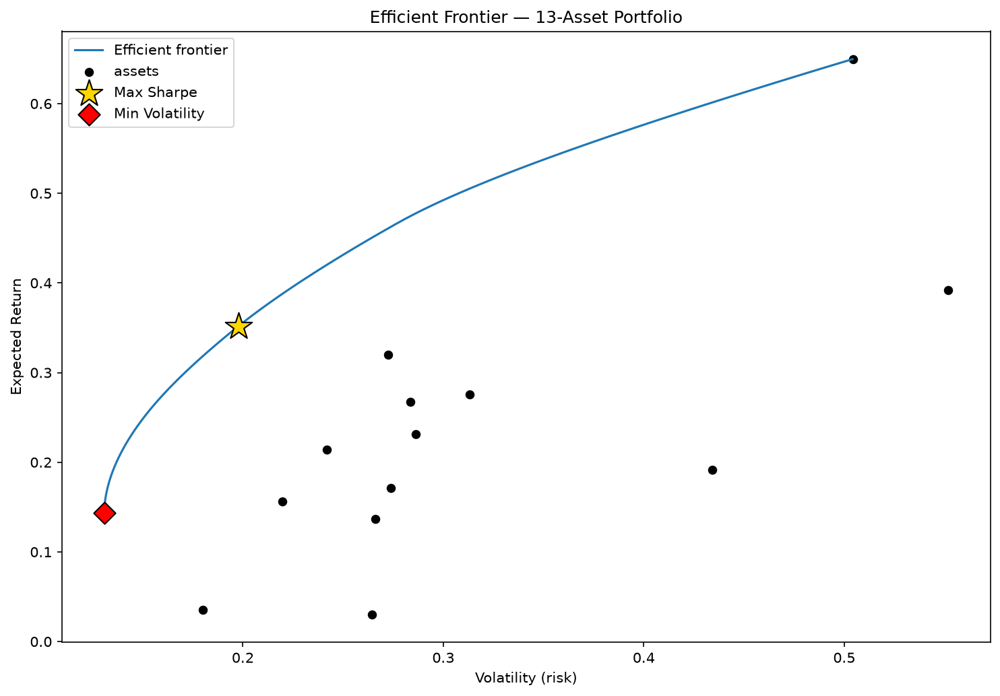
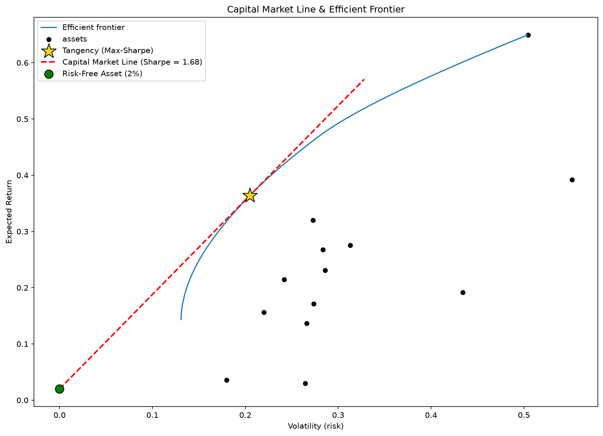
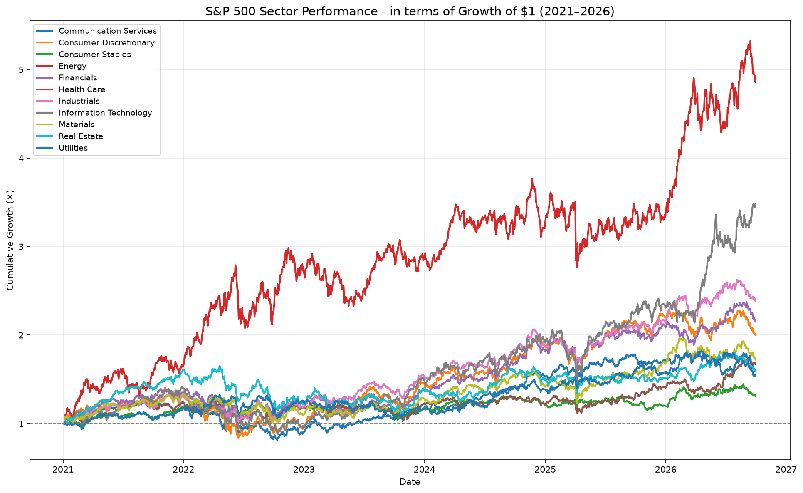
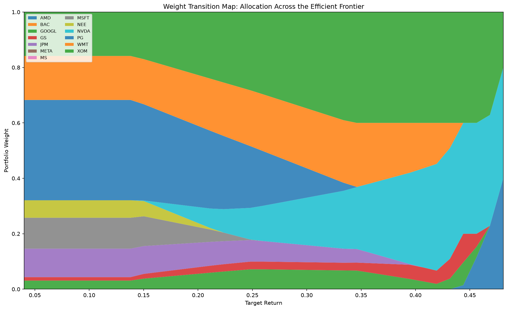
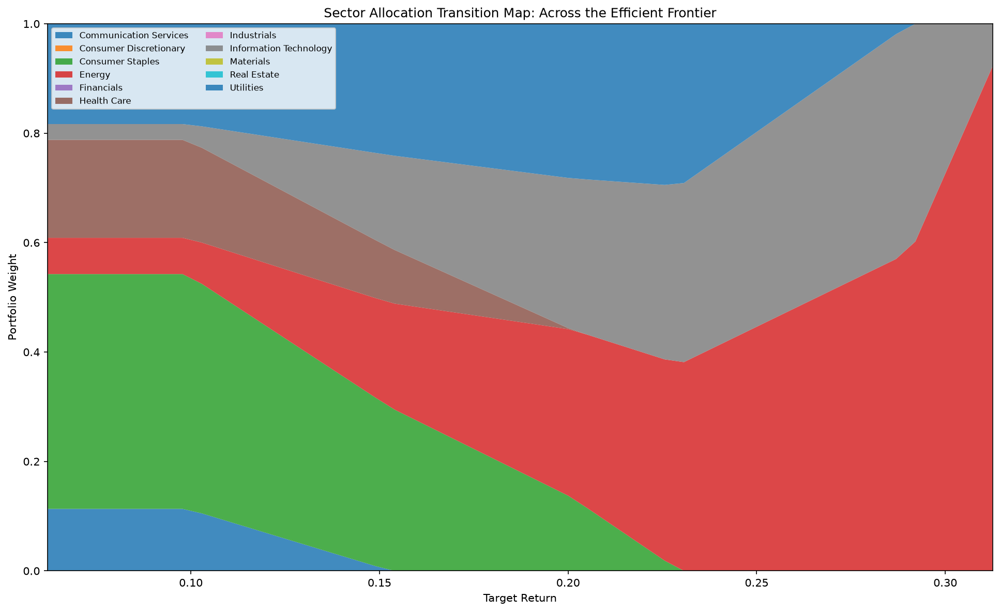
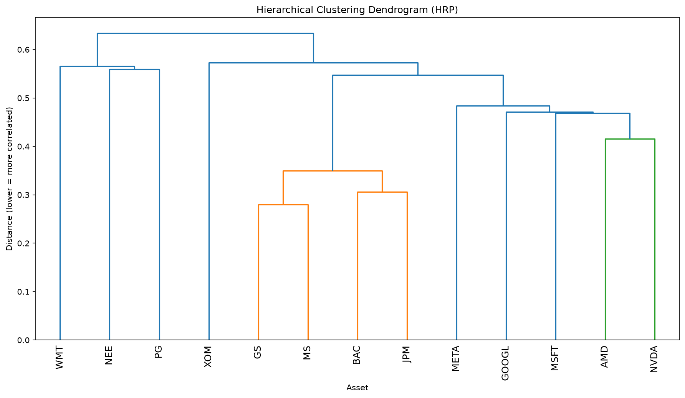
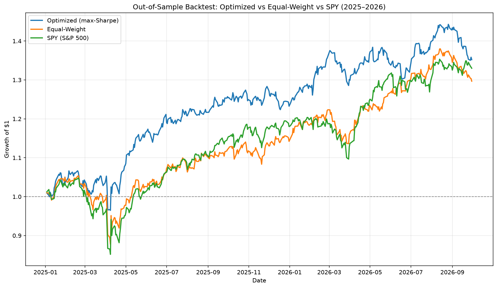

# Portfolio Optimization & Risk Allocation on the S&P 500

Equity portfolio optimization on ~250 S&P 500 stocks: efficient frontiers, max-Sharpe and min-volatility portfolios, Hierarchical Risk Parity, and out-of-sample backtesting against equal-weight and SPY benchmarks. Built with PyPortfolioOpt, pandas, and Matplotlib.

## Overview

This project implements and compares two approaches to portfolio construction. A classical **mean-variance optimization** (Markowitz) and modern **Hierarchical Risk Parity** (HRP) and validates them out-of-sample against naive benchmarks. The goal is not just to build an optimizer, but to test whether optimization actually adds value on data it has never seen.

## Data

- **Universe:** ~250 S&P 500 constituents, sampled proportionally across all 11 GICS sectors so the sample mirrors the real index's sector weights.
- **Source:** Daily adjusted-close prices from Yahoo Finance (`yfinance`), 2021–2026.
- **Adjusted close** is used throughout so returns account for dividends and splits.
- **Data hygiene:** stocks lacking sufficient history (recent IPOs/spinoffs) were removed via a 95%-completeness filter, then series were aligned to common trading dates. This avoids introducing gaps that would corrupt covariance estimates.

## Methodology

**Expected returns** are estimated from historical means (annualized). **Covariance** is estimated using **Ledoit-Wolf shrinkage**, which regularizes the noisy sample covariance toward a structured target and producing more stable out-of-sample portfolios than the raw sample matrix.

**Portfolios constructed:**
- **Max-Sharpe (tangency)** --maximizes return per unit of risk.
- **Min-volatility** -- the lowest-risk portfolio on the frontier.
- **Constrained variants** -- per-asset weight caps to prevent over-concentration (the "error maximization" problem that plagues unconstrained mean-variance at scale).
- **Hierarchical Risk Parity** -- clusters assets by correlation and allocates risk down the resulting tree, avoiding covariance-matrix inversion entirely.

## Results

### Efficient Frontier
The set of optimal risk-return portfolios, with the max-Sharpe and min-volatility portfolios marked. Every individual stock sits below and to the right of the frontier. A visual proof that diversified portfolios dominate single holdings.

### Capital Market Line
Introducing a risk-free asset transforms the curved frontier into a straight line tangent to it at the max-Sharpe portfolio. The line's slope is the Sharpe ratio (1.68). This is the two-fund separation theorem made visual.

### Sector Performance
Cumulative growth of each GICS sector, 2021–2026. Sector leadership rotated sharply, where **Energy** led the 2021–22 inflation era while **Information Technology** led the 2024–26 AI boom. In the 2022 drawdown Energy decoupled from the rest of the market, a textbook illustration of why cross-sector diversification reduces risk.

### Weight Transition Maps
How optimal allocation shifts with risk appetite. At low target returns the optimizer diversifies broadly across defensive assets; as the return target rises, allocation concentrates into the highest-return names — showing that return-seeking and diversification are in direct tension.

At the sector level, the same logic is cleaner: low-risk portfolios lean on Consumer Staples, Utilities, and Health Care, while high-return targets shift sharply into Energy and Information Technology. The sectors that actually led over the period.

### Hierarchical Risk Parity
HRP clusters assets by correlation (shown in the dendrogram) and allocates risk across the hierarchy. The tree recovered the sector structure with no labels, tightly clustering the banks (GS, MS, BAC, JPM) and the semiconductors (AMD, NVDA), while the diversifiers (XOM, PG, WMT, NEE) sit on isolated branches. HRP over-weights these lone-wolf diversifiers (which contribute unique risk) and under-weights the redundant clusters — the opposite emphasis from max-Sharpe.

### Out-of-Sample Backtest
The key validation. Max-Sharpe weights were frozen on 2021–2024 training data, then applied to unseen 2025–2026 test data and compared against equal-weight and SPY benchmarks.

| Strategy | Out-of-Sample Sharpe | Growth of $1 |
|---|---|---|
| **Optimized (max-Sharpe)** | **1.33** | $1.35 |
| Equal-Weight | 1.07 | $1.30 |
| SPY (S&P 500) | 1.05 | $1.33 |

The optimized portfolio beat both benchmarks out-of-sample, with a ~25% higher Sharpe ratio. Notably, the **in-sample** Sharpe was 1.78, and most of that apparent edge was estimation noise that evaporated out-of-sample. What survived is a genuine, honest, risk-adjusted improvement.

## Key Takeaways

- Mean-variance optimization is an **estimation problem**: its in-sample performance is inflated, and shrinkage plus position constraints are essential to control overfitting.
- **Equal-weight and the index are hard benchmarks to beat**, a few points of out-of-sample outperformance is a realistic, respectable result.
- **HRP** offers a more stable alternative by allocating risk hierarchically rather than trusting a noisy covariance matrix, producing in-sample numbers much closer to realized out-of-sample performance.

## Limitations

- **Survivorship bias:** the universe uses *current* S&P 500 constituents, so delisted/removed companies are excluded. An optimistic bias inherent to point-in-time constituent lists.
- The optimized portfolio draws from ~250 individual stocks while SPY tracks all 500, so the comparison is not perfectly apples-to-apples.
- Weights are single-period (no rebalancing within the test window).
- Expected returns are historical means — a famously weak predictor; the covariance structure does more of the real work.

## Tech Stack

Python · PyPortfolioOpt · pandas · NumPy · Matplotlib · SciPy · yfinance

## Author

Prithivan Raja
